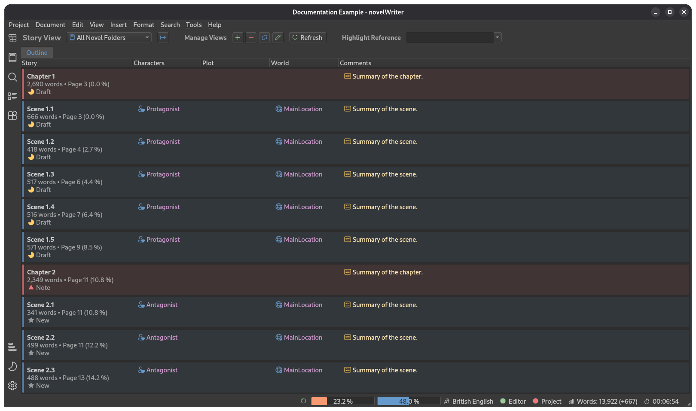
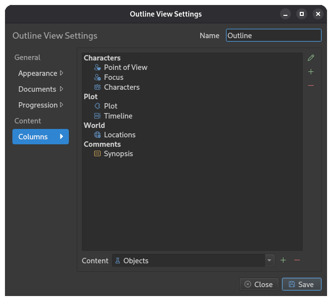

.. _docs_ui_story_view:

******************
Project Story View
******************

.. versionadded:: 26.3

The **Story View** is a new view in 26.3 that replaces the old basic table-based **Outline View**.
The view is activated from the side bar, and replaces the main project and editor view with a new
panel where multiple views of the project can be added as tabs. By default, a new **Outline** is
generated the first time the project is opened.

You can add multiple outlines, and name them however you like. More types of views will be added in
future releases.

The **Story View** can show one Novel folder at a time, or combine all of them into a single view.
Adding, editing and deleting views is handled via a set of tool buttons along the top, and a
reference search box lets you highlight specific references in the current active view so they are
easier to locate.

The view should generally refresh when you navigate to it, but in case something isn't updated, a
refresh button is available in the toolbar. These views depend on an up to date project index. In
case something isn't right, try pressing :kbd:`F9` to refresh the index.

.. _docs_ui_story_view_outline:

Outline View
============

   A screenshot of the Outline View in the Story View tool.

The **Outline** is designed to show all types of meta data collected about documents in your Novel
folders. A default set of columns are presented when you create an outline, but most aspects of it
can be edited.

Clicking the edit button in the toolbar will show you a settings panel for the currently active
outline. There are many ways to customise the view from these settings, like choosing what document
types to include, whether to show text labels or use icons, how many lines each row should span,
etc. You can easily create a separate outline for you chapters and for your scenes, with different
information presented.

Columns, aside from the first one, are entirely customisable. The first column will always show the
title of the partition, chapter, or scene. It can also optionally show story progression, that is,
how far into the project a given section is placed. Either in terms of word count percentage of the
total, or in terms of an estimated page number. If you have defined a project target word or
character count in **Project Settings**, this can be used as a basis for the progress calculation.
See :ref:`docs_ui_projects_settings_goal` for more details.

Column Settings
---------------

   A screenshot of the Columns page of the Outline View Settings.

You define yourself what columns you want, what they're labelled, and what information is shown in
each column. You can select up to five fields for each column.

This flexibility lets you add your custom :ref:`docs_features_story` to the outline, without
wasting a lot of space on empty columns for those that are rarely used. You can also group them in
whatever way suits you, like is done in the default setup with the **Characters** column.

To generate synopsis text for your documents, you need to add such comments to your documents.
See :ref:`docs_usage_comments_synopsis` for more details.
